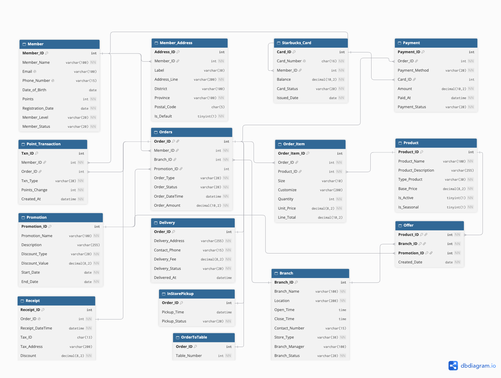
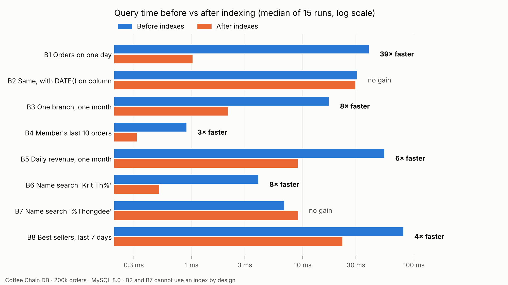

# Coffee Chain Database (MySQL 8)

A relational database for a coffee-chain ordering and membership system, modeled on Starbucks Thailand.
It covers schema design, 200,000+ rows of realistic generated data, business analytics in advanced SQL,
business rules enforced inside the database, and a measured indexing study.

> Originally a 5-person group project for ITCS216 Fundamentals of Database Systems
> (Mahidol University ICT, 1/2025). This version was redesigned and extended by
> **Sirirampa Luangphiphatsorn**.
> Original team: Chanachon Ruanpheng, Yanapat Sittirat, Chanapron Sumkhemthong, Ratchanon Srithongkul.
>
> *Educational project, not affiliated with Starbucks.*

## Highlights

| | |
|---|---|
| **Schema** | 15 tables (11 → 15) in 3NF, plus two deliberate cached totals kept in sync by triggers. CHECK / UNIQUE / FK constraints and 3 order subtypes (pickup, table, delivery) |
| **Data** | 20,010 members · 50 branches · 200,018 orders · 378,720 order lines, generated in pure SQL and passing 13 integrity checks |
| **Analytics** | 12 business questions using CTEs, window functions (LAG, RANK, NTILE, moving averages, median) and a recursive CTE |
| **Business rules** | 9 triggers, 1 function, 4 stored procedures, with one-transaction order placement and automatic rollback |
| **Performance** | `EXPLAIN ANALYZE` before/after indexing. Day lookup **50 ms → 1.7 ms** (200,020 → 492 rows read). Analytics script **9.3 s → 6.4 s** |

**Full report (20 pages):** [docs/Coffee_Chain_Database_Report.pdf](docs/Coffee_Chain_Database_Report.pdf)

## ER diagram



Source: [`docs/erd_v2.dbml`](docs/erd_v2.dbml), which can be pasted into [dbdiagram.io](https://dbdiagram.io).

## What changed from the original (v1 → v2)

The full reasoning for all 19 decisions is in [`docs/schema-v2-decisions.xlsx`](docs/schema-v2-decisions.xlsx). The main ones:

- `DATE` → `DATETIME` for order and pickup times, so peak-hour analysis becomes possible.
- `Contain` became `Order_Item` with its own key. The same drink with two different customisations can now be in one order.
- Added `Delivery`, `Starbucks_Card`, `Payment` and `Point_Transaction` to match the business process the v1 report described.
- `Order_Amount` is now kept correct by triggers. In v1, order 400001 stored **120** while its items added up to **380**.
- Promotion status is computed from dates in a view instead of being typed in, so it can't go stale.
- Added `Base_Price`, `Discount_Value`, `UNIQUE` email/phone and `AUTO_INCREMENT` keys, and renamed the reserved word `Order` to `Orders`.

## Repository structure

```
coffee-chain-database/
├── schema/
│   └── schema_v2.sql            # tables, constraints, view, order-amount triggers
├── seed/
│   ├── seed_small.sql           # readable sample data migrated from v1 (fixed)
│   ├── seed_large.sql           # 200k-order generator (pure SQL, repeatable)
│   └── verify_data.sql          # 13 integrity checks, all must return 0
├── queries/
│   ├── 01_views.sql             # 4 reporting views
│   ├── 02_analytics.sql         # 12 business questions
│   ├── 03_triggers.sql          # business-rule triggers
│   ├── 04_procedures.sql        # fn_calc_discount + 4 stored procedures
│   └── 05_demo.sql              # shows each rule ALLOWING or BLOCKING
├── performance/
│   ├── 01_benchmark_queries.sql # 8 queries with EXPLAIN ANALYZE
│   ├── 02_create_indexes.sql    # indexes and the reason for each
│   ├── 03_drop_indexes.sql      # back to the "before" state
│   ├── benchmark.py             # optional automatic timing
│   └── results.csv
├── docs/                        # ERD, decisions, performance write-up, report
└── v1-original/                 # the original group-project SQL, unchanged
```

## How to run

Requires MySQL 8.0+ (tested on 8.0 and 8.4). Run the files in this order, in MySQL Workbench or the `mysql` client:

| Step | File | Time |
|---|---|---|
| 1 | `schema/schema_v2.sql` | seconds |
| 2 | `seed/seed_small.sql` | seconds |
| 3 | `seed/seed_large.sql` | ~1–3 min |
| 4 | `queries/01_views.sql` → `02_analytics.sql` | ~10 s |
| 5 | `queries/03_triggers.sql` → `04_procedures.sql` → `05_demo.sql` | seconds |
| 6 | `seed/verify_data.sql` (every check should be 0) | seconds |
| 7 | `performance/01` → `02` → `01` again (before / after) | seconds |

Run the triggers (step 5) **after** the seed data, otherwise points and card charges would be applied twice.

## Examples

**Placing an order is one transaction.** The procedure validates the input, writes the order, items,
receipt and payment, then the triggers charge the card and award points. If anything fails, everything rolls back.

```sql
CALL sp_place_order(
    100011, 1001, 'InStorePickup',
    '[{"product_id":200002,"qty":2,"size":"Grande","customize":"Oat milk"},
      {"product_id":200029,"qty":1}]',
    NULL, 'StarbucksCard', 600007, NULL, '2026-10-01 08:30:00', @order_id);
```

**Rules the database enforces** (from `05_demo.sql`): it blocks discontinued products,
table orders at Drive Thru branches, orders outside opening hours, expired promotions, cash for delivery,
someone else's Starbucks Card, insufficient card balance, banned members, redeeming more points than owned,
and re-opening or cancelling completed orders.

**Analytics**, for example RFM segmentation:

| Segment | Customers | Share of revenue |
|---|---:|---:|
| Champions | 3,062 | 27.5% |
| Loyal | 4,835 | 26.3% |
| At Risk | 4,104 | 23.7% |
| Hibernating | 3,898 | 10.7% |

## Performance results

| Query | Before | After | Rows read |
|---|---:|---:|---|
| Orders on one day | 39.4 ms | 1.0 ms | 200,022 → 492 |
| One branch, one month | 17.3 ms | 2.1 ms | 13,142 → 1,779 |
| Daily revenue, one month | 54.4 ms | 9.0 ms | 203,841 → 27,447 |
| Name search `'Krit Th%'` | 4.0 ms | 0.5 ms | 20,012 → 30 |
| Best sellers, last 7 days | 80.6 ms | 22.8 ms | 221,160 → 24,428 |
| `DATE(column) = ...` | 30.8 ms | 29.8 ms | no index possible |
| Name search `'%Thongdee'` | 6.8 ms | 9.1 ms | no index possible |



What I learned along the way:
- A function around a column (`DATE(col)`) stops MySQL from using the index on it.
- An index that starts with a column of almost one value (`Payment_Status`, 99.99% 'Success') made two queries 2× slower, so I moved it.
- Rewriting one query was 40× faster than any index could make it.
- The indexes made inserts about 2.8× slower.

Full write-up: [`docs/performance-results.md`](docs/performance-results.md)

## Notes

- All data is synthetic. Patterns such as growth over time and promotion uplift come from rules in the generator,
  so the analytics demonstrate the SQL, not real customer behaviour.
- Timings were measured on MySQL 8.0 in a test environment. Absolute numbers differ by machine, but the rows-read counts do not.

## Tech

MySQL 8 · SQL (DDL, DML, CTE, window functions, JSON_TABLE, triggers, stored procedures) · MySQL Workbench · dbdiagram.io · Python (benchmark, optional)
